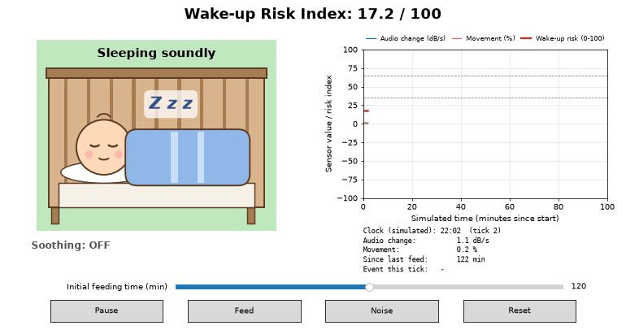

# Baby Monitor – rozmyty system oceny ryzyka wybudzenia

System oparty na **logice rozmytej** (biblioteka [Simpful](https://github.com/aresio/simpful)), który ocenia, jak bardzo prawdopodobne jest wybudzenie śpiącego niemowlęcia. Wynikiem jest wskaźnik **Risk (0–100)**. To ocena eksperta zapisana w regułach, a nie statystycznie zwalidowane prawdopodobieństwo.

## Wejścia systemu rozmytego

| Wejście | Zakres | Znaczenie |
|---|---|---|
| **Audio** | -100 … 100 dB/s | Zmiana poziomu dźwięku w czasie. Wartość dodatnia oznacza nagły wzrost hałasu (np. płacz), ujemna – spadek (skończył się prąd w głośniku z kołysanką). |
| **Movement** | 0 … 100 % | Ilość ruchu widoczna w obrazie z kamery. |
| **Feeding** | 0 … 240 min | Czas od ostatniego karmienia. |

**Jak liczone są sygnały z czujników (założenie projektowe):**

- **Audio** to zmiana poziomu RMS sygnału z mikrofonu, czyli pochodna po czasie: `(poziom_dB(t) − poziom_dB(t−1)) / Δt`.
- **Movement** to różnica klatek (*frame difference*) z kamery. Porównujemy kolejne klatki w skali szarości i liczymy, jaki procent pikseli zmienił się powyżej progu: `100 · liczba_zmienionych_pikseli / liczba_wszystkich_pikseli`.

> W tym repozytorium nie ma przechwytywania obrazu ani dźwięku. Wartości wejściowe pochodzą z suwaków (`main.py`) albo z symulatora (`simulation.py`). Opis wyżej pokazuje, jak byłyby wyznaczane w prawdziwym urządzeniu.

Funkcje przynależności i reguły są w `fuzzy_logic.py`. Wykresy funkcji przynależności: [input-variables.png](input-variables.png).

## Dwie aplikacje

- `main.py` – interaktywne **suwaki**: ustawiasz audio, ruch i czas od karmienia, a system od razu pokazuje ryzyko.
- `simulation.py` – **symulacja w czasie rzeczywistym**: wirtualne dziecko śpi w łóżeczku, a dźwięk, ruch i czas od karmienia zmieniają się co symulowaną minutę. Losowe zdarzenia (płacz, poruszenie) podnoszą ryzyko. Gdy ryzyko jest wysokie, włącza się „kołysanie" i ryzyko spada. Przyciski: Start/Pause, Feed, Noise, Reset oraz suwak początkowego czasu od karmienia.



## Uruchomienie

Wymagany Python 3.10 lub nowszy. Polecenia wykonuj w katalogu `baby_monitor/`.

**Linux / macOS**

```bash
python3 -m venv venv
source venv/bin/activate
pip install -r requirements.txt

python main.py          # suwaki
python simulation.py    # symulacja
```

**Windows (PowerShell / cmd)**

```bat
python -m venv venv
venv\Scripts\activate
pip install -r requirements.txt

python main.py
python simulation.py
```

Przydatne opcje symulacji: `--seed N` (powtarzalny przebieg), `--feeding MIN` (początkowy czas od karmienia), `--save plik.gif --frames N` (zapis GIF-a bez okna).

## Dokumentacja

```bash
python -m pdoc -o docs fuzzy_logic main simulation
```

## Autorzy

- Jakub Kolad
- Igor Czeczot
